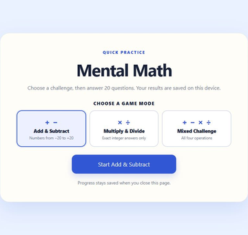

# Mental Math — 20 Question Challenge

**A small offline browser game for practising arithmetic with positive and negative numbers in three modes.**

Twenty questions, immediate feedback, a review of every answer, and a reason to try again.

[Play in your browser](https://vytenisnarmontas.github.io/mental-math-game/) · [Download the offline ZIP](https://github.com/VytenisNarmontas/mental-math-game/raw/refs/heads/main/downloads/Mental-Math-20.zip) · [Download the single HTML file](https://github.com/VytenisNarmontas/mental-math-game/raw/refs/heads/main/index.html)

| Choose a challenge | Review the whole round |
| :---: | :---: |
|  |  |

*Actual browser screenshots from demonstration rounds. Click an image for the full-size view.*

---

## Why I made it

One of my students was getting mixed up when adding and subtracting negative numbers. For example, `−5 + 4` could become `−9`, when the answer should be `−1`. I wanted to give them a simple way to practise these calculations in their browser.

I had previously made a similar game myself in Python. It ran in the terminal and was packaged as a Windows `.exe`. For this version, I wanted something the student could open as a web page, with a small challenge to finish and a clear way to see how they had done.

## How it plays

1. Choose a mode and start a **20-question round**.
2. Type a whole-number answer and press **Enter** or **Check**. The game gives feedback immediately and shows the correct answer after a mistake.
3. Continue to the results screen to see the correct/wrong totals and **all 20 answers**.
4. **Play This Mode Again** to improve your score, or **Choose Another Mode**. Beating a saved best in that mode or getting **20/20** brings a celebration, including **WOW! PERFECT SCORE!** for a perfect round.

### Three ways to practise

| Mode | Questions |
| --- | --- |
| **Add & Subtract** | Addition and subtraction with both given numbers from **−20 to +20**. |
| **Multiply & Divide** | Multiplication with both factors from **−10 to +10**; division with a dividend from **−100 to +100**, a nonzero divisor from **−10 to +10**, and an exact whole-number answer from **−10 to +10**. |
| **Mixed Challenge** | All four operations, using the same number rules. |

Every Multiply & Divide and Mixed round includes at least one division with **two negative numbers**, such as `−45 ÷ (−5)`. Its position is shuffled into the round. Division by zero and fractional division answers are never generated.

Completed attempts stay in that browser. Each mode has its **own high score, attempt count and history**, so switching modes does not compare different kinds of practice. Older saved attempts without a mode count as Add & Subtract. There is no account to create.

## From a terminal game to a browser game

- **Before this version:** I built the earlier Python terminal game around the same practice idea.
- **Around September 2026:** the browser version was made in **one sitting** with AI. It grew from a simple answer checker into 20-question rounds, answer review, replay and saved scores.
- **Earlier use:** I used the original addition/subtraction game with the student. They learned the calculations and stopped making those sign mistakes.
- **25 October 2026:** the game expanded to three modes while keeping the 20-question format. The update added a visual mode picker, separate scores, replay and mode-switching controls. Division was tightened to small, exact whole-number answers, with double-negative division guaranteed in each relevant round.

The idea and teaching goal were mine. I supplied the requirements, choices and feedback, including the round length, review, saved attempts and score celebrations. AI generated and revised the HTML, CSS and JavaScript and helped create the test harnesses.

## What works now, and its limits

The original game gave the student repeated practice with immediate correction and a visible result at the end. The current version adds more kinds of arithmetic while keeping that short practice loop.

Checks for this update covered **10,000 division questions** and **1,000 rounds in each mode**. Four complete browser demonstration rounds exercised feedback, review, mode-specific scores, replay, both celebrations and saved history after closing and reopening the tab. The small-screen mode cards were also checked. These are focused development checks; wider cross-browser and device coverage remains untested.

The number ranges are fixed within each mode, and the game shows the correct answer without explaining the steps. It keeps up to **200 completed rounds in total** across the modes; clearing browser data can remove them. An unfinished round starts over when the page is reopened. There is no teacher dashboard or score synchronization between devices.

## Try it

Use the browser link above, or download and extract the offline ZIP, then open **`Mental-Math-20.html`**. The single-file download and the repository's **`index.html`** are the same playable game. The ZIP also includes the license.

The downloaded game runs offline with JavaScript enabled. No installation, server, account, external library, API, internet connection or build tools are needed to play it.

[Playing, saved scores and troubleshooting](docs/USAGE.md)

## Ideas for later

Possible extensions include **fraction practice**, challenges and daily missions to make the game more entertaining to return to. Fractions are another area where many of my students need practice. These remain ideas for later.

## Credits and license

A hobby project by Vytenis Narmontas, created with AI assistance from my idea and instructions. The code, documentation and game screenshots are available under the [MIT license](LICENSE).
