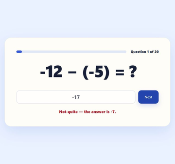
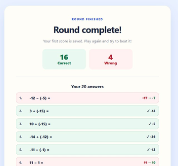

# Mental Math — 20 Question Challenge

**A small browser game for practising addition and subtraction with negative numbers.**

Twenty questions, immediate feedback, a review of every answer, and a reason to try again.

[Play in your browser](https://vytenisnarmontas.github.io/mental-math-game/) · [Download the offline copy](https://github.com/VytenisNarmontas/mental-math-game/archive/refs/heads/main.zip)

| Practise one question at a time | Review the whole round |
| :---: | :---: |
|  |  |

*Actual browser screenshots from demonstration rounds. Click an image for the full-size view.*

---

## Why I made it

One of my students was getting mixed up when adding and subtracting negative numbers. For example, `−5 + 4` could become `−9`, when the answer should be `−1`. I wanted to give them a simple way to practise these calculations in their browser.

I had previously made a similar game myself in Python. It ran in the terminal and was packaged as a Windows `.exe`. For this version, I wanted something the student could open as a web page, with a small challenge to finish and a clear way to see how they had done.

## How it plays

1. Start a **20-question round**. Each question uses addition or subtraction, with each number chosen from **−20 to 20**.
2. Type a whole-number answer and press **Enter** or **Check**. The game gives feedback immediately and shows the correct answer after a mistake.
3. Continue to the results screen to see the correct/wrong totals and **all 20 answers**.
4. Play again to improve your score. A new personal best or **20/20** gets a celebration.

Completed attempts are saved in that browser, so the start screen can show previous scores and the best score among the saved rounds. There is no account to create.

## From a terminal game to a browser game

- **Before this version:** I built the earlier Python terminal game around the same practice idea.
- **Around September 2026:** the browser version was made in **one sitting** with AI. It grew from a simple answer checker into 20-question rounds, answer review, replay and saved scores.
- **In use:** I used the game with the student. They learned the calculations and stopped making those sign mistakes.

The idea and teaching goal were mine. I asked for the round length, review, saved attempts and score celebrations; AI generated the HTML, CSS and JavaScript from my instructions.

## What works now, and its limits

The game does what I needed for this student: repeated practice with immediate correction and a visible result at the end. Browser checks also exercised complete rounds, wrong-answer feedback, replay, new-high-score and perfect-score messages, and saved history after closing and reopening the page.

The difficulty is fixed, and the game shows the correct answer without explaining the steps. It keeps up to **200 completed rounds** in the browser; clearing browser data can remove them. An unfinished round starts over when the page is reopened. There is no teacher dashboard or score synchronization between devices.

## Try it

Use the browser link above, or download and extract the ZIP, then open **`index.html`**. The downloaded game is a single self-contained file and can run offline with JavaScript enabled. No installation or build tools are needed.

[Playing, saved scores and troubleshooting](docs/USAGE.md)

## Ideas for later

Possible extensions include **fraction practice**, other game modes, challenges and daily missions to make the game more entertaining to return to. Fractions are another area where many of my students need practice. There is no update planned at the moment.

## Credits and license

A hobby project by Vytenis Narmontas, created with AI assistance from my idea and instructions. The code, documentation and game screenshots are available under the [MIT license](LICENSE).
