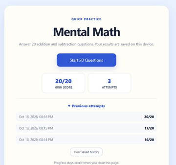
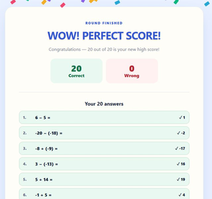

# Playing Mental Math

## Open the game

The hosted version is linked from the repository README. To keep an offline copy, choose **Code → Download ZIP** on GitHub, extract the downloaded folder and open `index.html` in a browser.

The page contains its own HTML, CSS and JavaScript. It uses system fonts and has no external packages, images, accounts or API keys to set up. JavaScript must be enabled. Only `index.html` is needed to play; the other repository files explain and demonstrate the project.

## A round

Select **Start 20 Questions**. Type an integer, including a minus sign when needed. Press **Enter** or **Check** to submit it, then **Enter** or **Next** to continue. After the last answer, **See Results** shows the score and all 20 answers. **Start Again** begins another round.

The two operands are chosen from −20 through 20, inclusive; answers can therefore range from −40 to 40. Rounds mix addition and subtraction and can include positive numbers, zero and negative numbers. A negative second operand is shown in parentheses, for example `−12 − (−5)`.

The game avoids repeating the exact same ordered expression within a round. It does not adapt the difficulty or explain a calculation step by step.

## Scores and celebrations

The first completed round establishes a score. A later round that beats the previous best gets a new-high-score message and confetti. Every perfect 20/20 round gets the perfect-score message and confetti. The animation is skipped when the browser reports a preference for reduced motion.

| Saved demonstration rounds | A perfect demonstration round |
| :---: | :---: |
|  |  |

*Authentic browser captures using demonstration answers.*

## Where progress is kept

Only **finished rounds** are saved. Each stored attempt contains its completion time, score and submitted answers. The game retains the most recent 200 attempts in browser `localStorage`. The displayed high score is the best among those retained attempts.

Keep using the same browser and location to see the same history. A downloaded file and the hosted page have separate storage, and moving or renaming a local file may affect which saved history the browser makes available. Private browsing, blocked storage or clearing site data can also affect persistence. If saving is blocked, the game displays a warning and still lets you play. The game does not upload answers or synchronize them between devices.

**Clear saved history** asks for confirmation before removing the stored attempts. Closing a page during a round does not save or resume that unfinished round.

## If something does not work

- **The page opens as text:** extract the ZIP first and open `index.html` with a web browser.
- **An answer is rejected:** enter a whole number, such as `−7` using the keyboard's normal minus/hyphen key, or `12`. Decimals and words are not accepted. Some phone number keyboards may require switching to the symbols layout to enter a minus sign.
- **History is missing:** check that you are using the same browser and copy/location, and that browser storage is allowed. Storage behavior for files opened directly from disk varies between browsers.
- **No confetti:** the animation respects the browser's reduced-motion setting.

## Development notes

The complete game is in `index.html`. Question generation, answer checking, results, local history and confetti are implemented inline; no build step or dependency installation is required.

For portfolio preparation on October 18, 2026, real desktop-browser interaction checked four complete demonstration rounds, scoring and review, replay, both celebration messages, and saved scores after closing and reopening the tab. A further check confirmed that words, decimals and empty answers are rejected, signed integers are accepted, and a complete round can be played with Enter.

The publication copy includes a one-character correction to the HTML answer pattern so current browsers enforce the intended integer-only input. The relevant browser behavior is described in [MDN's HTML pattern reference](https://developer.mozilla.org/en-US/docs/Web/HTML/Reference/Attributes/pattern).

These browser checks used a temporary local web address. Persistence after a full browser restart, direct-file storage across browsers, mobile keyboards and a wider range of devices were not checked. The owner separately reports that the game worked as intended with the student.
